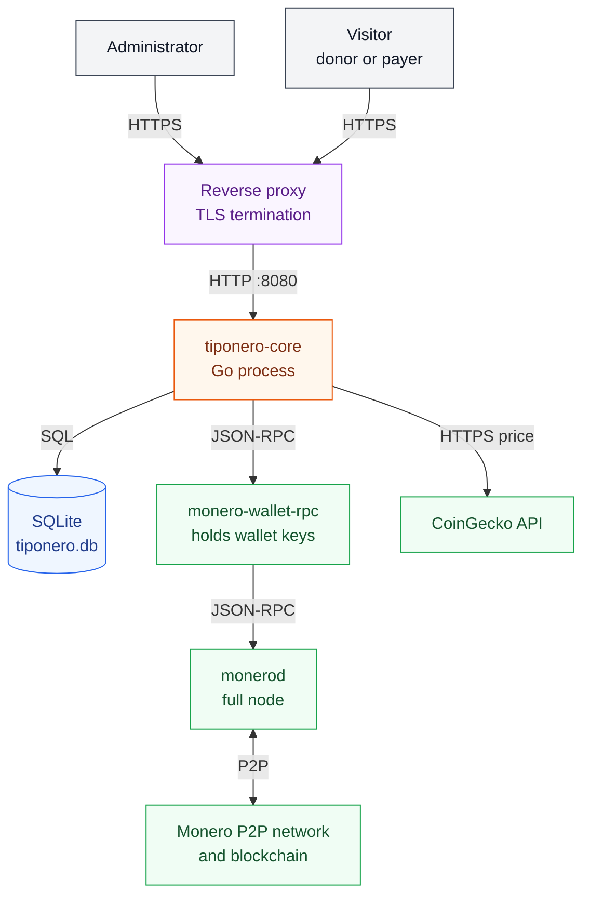
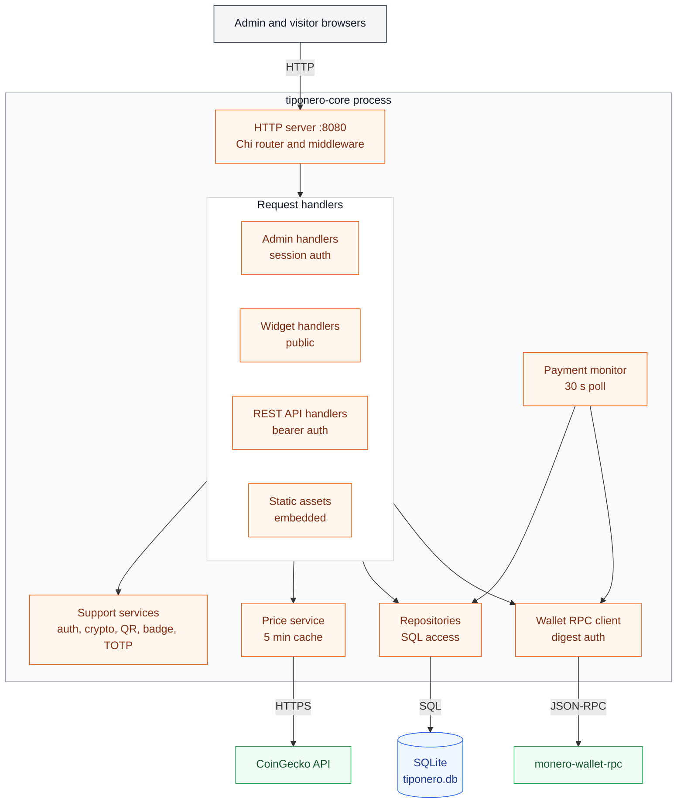
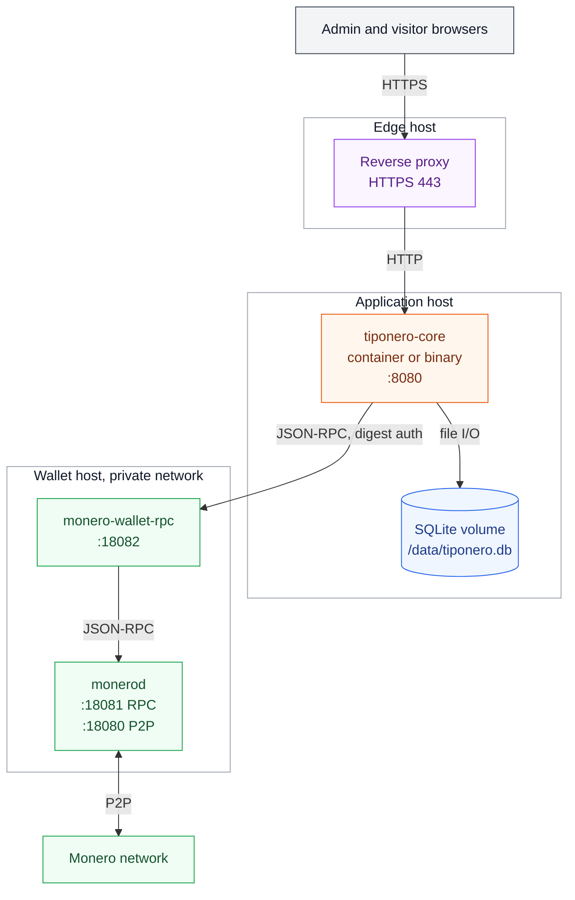

# System Architecture

Tiponero Core is a self-hosted Monero payment engine. This document shows the parts of a deployed system, the protocols between them, and the data each part holds.

**Audience:** maintainers and operators.

**Scope:** the deployed system and its runtime dependencies. Business flows are in [flows.md](./flows.md). The database schema is in [data-model.md](./data-model.md).

## 1. At a glance

| Property | Value |
|---|---|
| Runtime | One Go process |
| HTTP port | `PORT`, default `8080` |
| State | One SQLite file, WAL mode |
| Frontend | Server-rendered templ, HTMX 2, Alpine.js 3 |
| Wallet access | `monero-wallet-rpc` over HTTP JSON-RPC 2.0 |
| Price data | CoinGecko public API |
| External database | None |
| Build outputs | Single binary, Docker image, Nix package |

The process has three jobs:

1. Serve the admin interface and the public widget pages.
2. Record each transaction and its subaddress in SQLite.
3. Poll the wallet for incoming transfers and update transaction status.

The process is stateless between restarts. All durable state is in the SQLite file. The only in-memory state is the fiat price cache and the live wallet RPC client.

## 2. System context

### 2.1 Context elements

Colors show the role. Gray marks actors. Purple marks the edge proxy, orange marks the application, blue marks the data store, and green marks external systems.

| Element | Trust zone | Responsibility |
|---|---|---|
| Administrator | Public network | Creates widgets, configures the wallet, reads transactions |
| Visitor | Public network | Opens a widget, pays or donates XMR |
| Reverse proxy | Edge | Terminates TLS and forwards requests to the app |
| tiponero-core | Application host | Serves pages, stores transactions, polls the wallet |
| SQLite file | Application host | Stores users, widgets, transactions, wallet config, API keys |
| monero-wallet-rpc | Wallet host | Creates subaddresses, reports transfers, holds the wallet keys |
| monerod | Wallet host | Validates and relays transactions, serves chain data |
| Monero network | Public network | Peer-to-peer network that confirms transactions |
| CoinGecko API | Public network | Supplies the XMR to fiat exchange rate |

The application never holds a Monero seed, a private view key, or a private spend key. `monero-wallet-rpc` holds them. Tiponero stores only the RPC credentials and an optional wallet file name and password.

## 3. Inside the process

### 3.1 Component responsibilities

| Component | Package | Responsibility |
|---|---|---|
| HTTP server | `internal/handlers` | Routes requests, applies middleware, renders templates |
| Admin handlers | `internal/handlers/admin.go` | Login, dashboard, widgets, settings, CSV export |
| Widget handlers | `internal/handlers/widget.go` | Public page, transaction creation, status, QR, badge |
| REST API handlers | `internal/handlers/api.go` | JSON API for widgets, transactions, user, wallet, keys |
| Auth service | `internal/auth` | bcrypt passwords, cookie sessions, API key checks, TOTP gate |
| Crypto | `internal/crypto` | HKDF-SHA256 key derivation, AES-256-GCM encryption |
| Repositories | `internal/database` | Schema creation and SQL queries |
| Monero client | `internal/monero` | JSON-RPC calls, digest auth, connection status |
| Payment monitor | `internal/services/monitor.go` | Expiry sweep, transfer polling, amount verification |
| Price service | `internal/services/price.go` | CoinGecko fetch with a 5 minute cache |
| QR and badge | `internal/services/qrcode.go`, `badge.go` | PNG QR codes and SVG badges |
| TOTP | `internal/services/totp.go` | Secret generation and code validation |
| Config | `internal/config` | Environment values and defaults |

The HTTP handlers and the payment monitor share the same repository and wallet client. The monitor runs in a separate goroutine. It does not serve requests.

## 4. External interfaces

### 4.1 Wallet RPC methods

The client calls `<rpc_url>/json_rpc` with JSON-RPC 2.0. If `rpc_user` is set, the client uses HTTP digest authentication.

| Method | Caller | Purpose | Failure behavior |
|---|---|---|---|
| `create_address` | Widget handler | Create one subaddress per transaction | Visitor sees an error page, the handler stores no transaction |
| `get_transfers` | Payment monitor | Read incoming, pending, and pool transfers | The monitor logs the error and keeps the status, retry after 30 s |
| `get_height` | Wallet status card | Show the wallet chain height | Status shows disconnected |
| `open_wallet` | Startup and settings save | Open the configured wallet file | Warning only, the process continues |

`create_address` uses account index `0`. The label is `tx-` plus 16 random bytes in hex.

### 4.2 HTTP surface

| Group | Path prefix | Authentication | Purpose |
|---|---|---|---|
| Admin | `/admin` | Session cookie, optional TOTP | Dashboard, widgets, transactions, settings |
| REST API | `/api/v1` | Bearer API key | Programmatic control |
| Widget | `/widget` | None | Public payment and donation pages, QR, badge |
| Health | `/health` | None | Returns `OK` |
| Static | `/static` | None | Embedded CSS, JavaScript, images |

The widget group is public by design. A widget URL is the payment entry point. The widget ID is a UUID and acts as an unguessable capability.

### 4.3 Outbound dependencies

| Dependency | Protocol | Timeout | Caching |
|---|---|---|---|
| `monero-wallet-rpc` | HTTP or HTTPS JSON-RPC | 30 s | None |
| CoinGecko | HTTPS | 10 s | 5 min in memory, stale value on error |
| Google Fonts | HTTPS, from the browser | Browser default | Browser cache |

The pages load Space Grotesk, Inter, JetBrains Mono, and Material Symbols from Google Fonts. This is a browser-side dependency. It does not affect payment processing.

## 5. Deployment view

The diagram shows the host layout and the payment path. It omits the CoinGecko call to keep the layout clear. The app calls `api.coingecko.com` over HTTPS from the application host.

### 5.1 Supported topologies

| Topology | Start command | Notes |
|---|---|---|
| Docker Compose | `docker compose up -d` | Named volume `tiponero-data` mounted at `/data` |
| Nix | `nix build` then `./result/bin/tiponero` | All build tools come from the flake |
| Local build | `make build` then `./bin/tiponero` | Needs Go, templ, and Tailwind CSS |
| Development | `make dev` | Air rebuilds on change, proxy on `:8081` |

The Docker image uses a multi-stage build. The runtime stage is `gcr.io/distroless/base-debian12`. The binary needs CGO because the SQLite driver is `mattn/go-sqlite3`.

### 5.2 Network ports

| Hop | Default port | Protocol |
|---|---|---|
| Browser to reverse proxy | 443 | HTTPS |
| Reverse proxy to app | 8080 | HTTP |
| App to wallet RPC | 18082 | HTTP JSON-RPC |
| Wallet RPC to monerod | 18081 | HTTP JSON-RPC |
| monerod to Monero network | 18080 | P2P |
| App to CoinGecko | 443 | HTTPS |

The app does not terminate TLS. Put it behind a reverse proxy and set `BASE_URL` to the public `https://` URL. The app then sets the `Secure` flag on session cookies.

## 6. Trust boundaries and secrets

| Data | Storage form | Key source |
|---|---|---|
| Admin password | bcrypt hash | Not encrypted |
| Session cookie | Signed cookie value | HKDF-SHA256(`ENCRYPTION_KEY`, `session`) |
| TOTP secret | Plain text | Not encrypted |
| API key | bcrypt hash plus 8 character prefix | Not encrypted |
| Wallet RPC password | AES-256-GCM, base64 | HKDF-SHA256(`ENCRYPTION_KEY`, `wallet`) |
| Wallet password | AES-256-GCM, base64 | HKDF-SHA256(`ENCRYPTION_KEY`, `wallet`) |
| Wallet RPC URL and user | Plain text | Not encrypted |

`ENCRYPTION_KEY` is the root secret. If it changes, the app cannot decrypt the stored wallet passwords. Startup then stops with `failed to load wallet config`.

Security properties of the current design:

- Session cookies use `HttpOnly`, `SameSite=Lax`, and `Secure` when `BASE_URL` starts with `https`.
- Admin forms have no CSRF token. `SameSite=Lax` blocks cross-site form posts in current browsers.
- The app sets no security headers. Do not add `X-Frame-Options` for `/widget/*`, because sites embed the widget in iframes.
- Admin login has no rate limit or lockout.
- The public widget and badge endpoints have no rate limit.
- `monero-wallet-rpc` must stay on a private network. It holds the wallet keys and accepts commands.

## 7. Lifecycle

### 7.1 Startup

1. Read `.env` if the file exists.
2. Load environment values and apply defaults.
3. Warn when `ENCRYPTION_KEY` is short or equal to the example value.
4. Derive the session key and the wallet key with HKDF-SHA256.
5. Open SQLite, enable WAL and foreign keys, and create missing tables and indexes.
6. Create the default admin user `admin` with password `admin` when the `user` table is empty.
7. Load the user and the wallet config. Decrypt the wallet passwords.
8. Create the wallet RPC client. Call `open_wallet` when a wallet file is set.
9. Start the payment monitor goroutine.
10. Start the HTTP server on `PORT`.

### 7.2 Shutdown

`SIGINT` or `SIGTERM` starts a graceful shutdown:

1. Cancel the monitor context. The monitor stops at the next select.
2. Call `server.Shutdown` with a 10 second timeout.
3. Close the database.

## 8. Failure modes

| Failure | Effect | Recovery |
|---|---|---|
| Wallet RPC not configured | New transactions show "Payments are not available yet" | Set the wallet config in Settings |
| Wallet RPC unreachable | New transactions show "Wallet is currently unavailable" | Retry when the RPC is back |
| `get_transfers` fails | Status stays at the last value | Next poll after 30 s |
| Wallet RPC call exceeds 30 s | The request fails with a timeout error | Check the RPC and the network, then retry |
| `open_wallet` fails | Process continues, wallet status shows an error | Fix the wallet file or password in Settings |
| CoinGecko unreachable | The price service uses the stale price, or the fiat amount is `0` | Next request after the cache expires |
| SQLite write fails | Handler returns HTTP 500 | Check disk space and file permissions |
| `ENCRYPTION_KEY` changed | Startup stops at wallet config load | Restore the old key or re-enter the wallet config |
| Process killed | WAL recovery on next start | In-flight polls repeat, updates are idempotent |
| Chain reorganization | Confirmations can go down while the row is active. The status follows the new count | The row returns to a higher state after more blocks. A confirmed row is no longer polled |

## 9. Limits and scaling

- One process per database file. A second process would poll the same wallet and write the same rows.
- SQLite allows one writer at a time. WAL mode lets readers continue during a write.
- The monitor makes one `get_transfers` call for all active transactions per 30 second cycle.
- The admin transaction list shows 10 rows per page. The REST API defaults to 20 rows and caps at 100.
- Each open payment page polls the status endpoint every 3 seconds.
- Transactions are never deleted. There is no retention job.
- There is no rate limit on the login form, the widget endpoints, or the API.

## 10. Operations checklist

1. Set `ENCRYPTION_KEY` to a random value of 32 characters or more. Keep it stable.
2. Change the default admin password after the first login.
3. Enable TOTP for the admin account.
4. Put `monero-wallet-rpc` on a private network and set a digest password.
5. Terminate TLS at a reverse proxy. Set `BASE_URL` to the public HTTPS URL.
6. Back up the SQLite file with `sqlite3 tiponero.db ".backup backup.db"` or a volume snapshot.
7. Monitor `GET /health` and the process log on stderr.
8. Keep enough disk space for the database and its WAL files.

`/health` returns `OK` without a database or wallet check. It shows that the process accepts connections. It does not show that the wallet works. Use the admin dashboard wallet card for that.

## 11. Configuration facts

The code reads these values from the environment. The table lists the code default, not the README default.

| Variable | Code default | Notes |
|---|---|---|
| `PORT` | `8080` | Listen port |
| `BASE_URL` | `http://localhost:<PORT>` | Used for badge URLs and cookie security |
| `DATABASE_PATH` | Empty | Empty path gives a temporary database, data is lost on restart |
| `ENCRYPTION_KEY` | Empty | No default. A short or empty key is insecure |
| `FIAT_CURRENCY` | `USD` | Passed to CoinGecko in lowercase |
| `CONFIRMATIONS` | `10` | Must be a positive integer |
| `TRANSACTION_EXPIRY` | `1h` | Go duration string |

The config package logs a warning for an empty `DATABASE_PATH` and an empty `ENCRYPTION_KEY`. The process still starts.

## 12. Source map

| Path | Contents |
|---|---|
| `cmd/tiponero/main.go` | Wiring, startup, shutdown |
| `internal/config/config.go` | Environment parsing |
| `internal/database/sqlite.go` | Connection, pragmas, schema |
| `internal/database/*.go` | Repositories per table |
| `internal/handlers/routes.go` | Route table and middleware |
| `internal/handlers/admin.go` | Admin pages and actions |
| `internal/handlers/widget.go` | Public widget flow |
| `internal/handlers/api.go` | REST API |
| `internal/auth` | Sessions, passwords, API keys |
| `internal/crypto/aes.go` | HKDF and AES-GCM |
| `internal/monero` | Wallet RPC client and client holder |
| `internal/services` | Monitor, price, QR, badge, TOTP |
| `internal/views` | templ templates |
| `static` | Embedded assets |

## Related documents

- [Flows](./flows.md)
- [Data model](./data-model.md)
- [Documentation index](./README.md)
