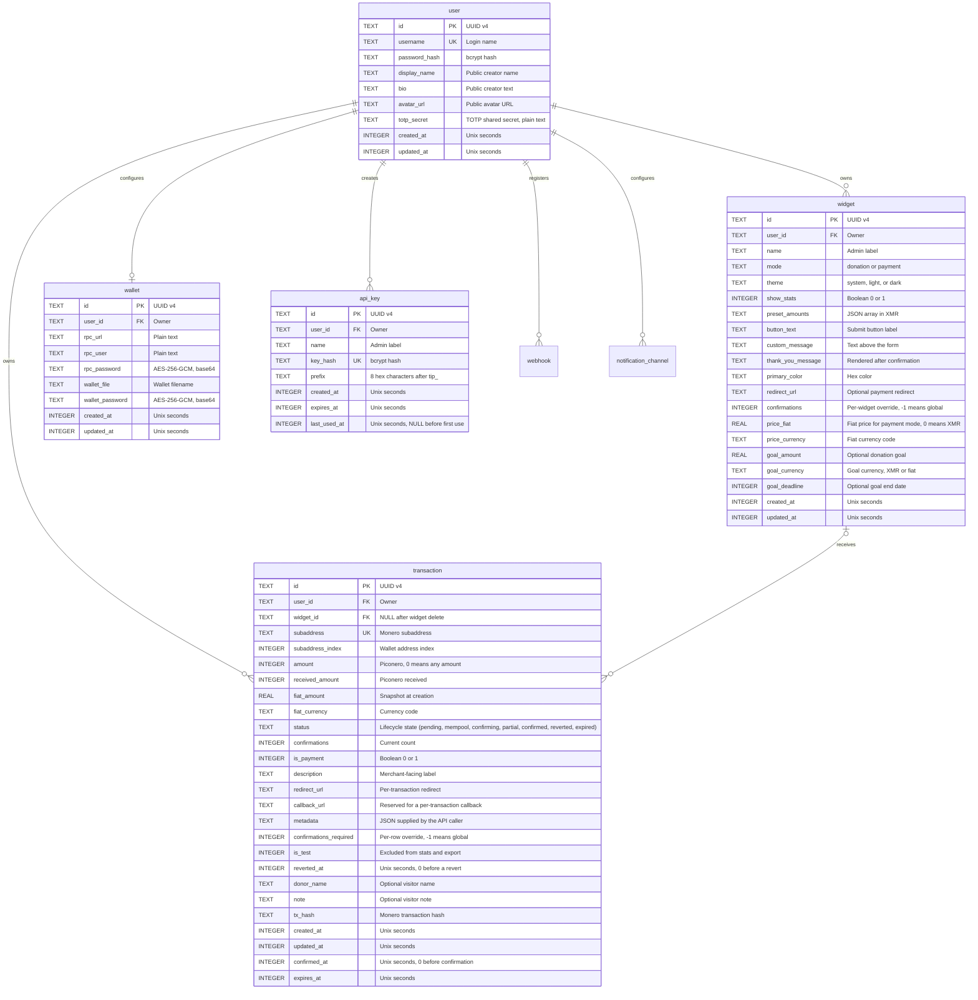

# Data Model

Tiponero Core stores all state in one SQLite database. This document describes the eight tables, their columns, their relations, and the conventions that the code applies to each value.

**Audience:** maintainers and operators.

**Scope:** the physical schema and the data rules in the Go code. Business flows are in [flows.md](./flows.md). Runtime components are in [architecture.md](./architecture.md).

## 1. Overview

| Property | Value |
|---|---|
| Engine | SQLite 3, driver `mattn/go-sqlite3` |
| File | `DATABASE_PATH`, default empty |
| Journal mode | WAL |
| Foreign keys | `PRAGMA foreign_keys=ON` after open |
| Tables | `user`, `widget`, `transaction`, `wallet`, `api_key`, `webhook`, `notification_channel`, `notification_delivery` |
| Schema owner | `internal/database/sqlite.go` |
| Migrations | Automatic. `CREATE TABLE IF NOT EXISTS` plus idempotent `ALTER TABLE` on every start |

The schema supports multiple users, but the application serves one user. `GetUser()` reads the first row with `LIMIT 1`. The startup code creates one admin when the table is empty. All widgets, transactions, wallets, and API keys belong to that user.

## 2. Entity relationship diagram



The relation `widget o|--o{ transaction` shows the nullable `widget_id`. A transaction keeps its row when the admin deletes its widget. The relation `user ||--o| wallet` is an application rule, not a database constraint. The `wallet` table has no unique index on `user_id`.

## 3. Table reference

### 3.1 `user`

| Column | Type | Null | Default | Description |
|---|---|---|---|---|
| `id` | TEXT | No | UUID v4 | Primary key |
| `username` | TEXT | No | None | Unique login name |
| `password_hash` | TEXT | No | None | bcrypt hash, cost 10 |
| `display_name` | TEXT | Yes | NULL | Shown on public widget pages |
| `bio` | TEXT | Yes | NULL | Shown on public widget pages |
| `avatar_url` | TEXT | Yes | NULL | Shown on public widget pages |
| `totp_secret` | TEXT | Yes | NULL | TOTP secret in plain text. NULL or empty means 2FA is off |
| `created_at` | INTEGER | No | None | Unix seconds |
| `updated_at` | INTEGER | No | None | Unix seconds |

The application reads this table with `SELECT ... FROM user LIMIT 1`. Most pages ignore a second row.

### 3.2 `widget`

| Column | Type | Null | Default | Description |
|---|---|---|---|---|
| `id` | TEXT | No | UUID v4 | Primary key and public URL token |
| `user_id` | TEXT | No | None | Owner, references `user(id)` |
| `name` | TEXT | No | None | Admin label |
| `mode` | TEXT | No | `donation` | `donation` or `payment` |
| `theme` | TEXT | No | `system` | `system`, `light`, or `dark` |
| `show_stats` | INTEGER | No | `1` | Boolean. Controls the badge statistics |
| `preset_amounts` | TEXT | Yes | NULL | JSON array of XMR amounts, for example `[0.01,0.05,0.1]` |
| `button_text` | TEXT | Yes | `Donate` | Submit button label |
| `custom_message` | TEXT | Yes | `Your support is appreciated!` | Text above the form |
| `thank_you_message` | TEXT | Yes | `Thank you for your donation!` | Rendered on the widget page after confirmation |
| `primary_color` | TEXT | Yes | `#ff6600` | Must match `^#[0-9a-fA-F]{6}$` at the handler |
| `redirect_url` | TEXT | Yes | NULL | Optional redirect after confirmation |
| `created_at` | INTEGER | No | None | Unix seconds |
| `updated_at` | INTEGER | No | None | Unix seconds |

`preset_amounts` uses XMR units as JSON numbers. It is not piconero. Payment mode requires exactly one value greater than zero. Donation mode accepts zero or more positive values.

### 3.3 `transaction`

| Column | Type | Null | Default | Description |
|---|---|---|---|---|
| `id` | TEXT | No | UUID v4 | Primary key |
| `user_id` | TEXT | No | None | Owner, references `user(id)` |
| `widget_id` | TEXT | Yes | NULL | References `widget(id) ON DELETE SET NULL` |
| `subaddress` | TEXT | No | None | Monero subaddress, unique |
| `subaddress_index` | INTEGER | No | None | Address index from the wallet |
| `amount` | INTEGER | Yes | NULL | Requested amount in piconero. `0` means any amount |
| `received_amount` | INTEGER | No | `0` | Total received in piconero. `0` before a transfer is seen |
| `fiat_amount` | REAL | Yes | NULL | Fiat value at creation. `0` for an open-amount donation |
| `fiat_currency` | TEXT | Yes | NULL | Currency code, for example `USD` |
| `status` | TEXT | No | `pending` | `pending`, `mempool`, `confirming`, `partial`, `confirmed`, `reverted`, or `expired` |
| `confirmations` | INTEGER | Yes | `0` | Last observed confirmation count |
| `is_payment` | INTEGER | No | `0` | Boolean. Copied from the widget mode at creation |
| `donor_name` | TEXT | Yes | NULL | Optional visitor name. Donation mode only |
| `note` | TEXT | Yes | NULL | Optional visitor note or payment reference |
| `tx_hash` | TEXT | Yes | NULL | Monero transaction hash, set by the monitor |
| `created_at` | INTEGER | No | None | Unix seconds |
| `updated_at` | INTEGER | No | None | Unix seconds |
| `confirmed_at` | INTEGER | Yes | NULL | Unix seconds. The app writes `0` before confirmation |
| `expires_at` | INTEGER | No | None | Unix seconds. Creation time plus `TRANSACTION_EXPIRY` |

`amount` is a signed 64 bit integer. One XMR is `1e12` piconero. The largest representable value is about 9.22 million XMR, which is above the Monero supply.

`received_amount` is the sum of all transfers to the subaddress. The monitor writes it on each poll. For a confirmed row created by an older version, the value is `0`. The statistics and the badge use `COALESCE(NULLIF(received_amount, 0), amount)` for confirmed rows, so old rows keep their requested amount in the totals.

`is_payment` records the mode at creation time. A later change to the widget mode does not change existing rows.

### 3.4 `wallet`

| Column | Type | Null | Default | Description |
|---|---|---|---|---|
| `id` | TEXT | No | UUID v4 | Primary key |
| `user_id` | TEXT | No | None | Owner, references `user(id)` |
| `rpc_url` | TEXT | Yes | NULL | Wallet RPC base URL, plain text |
| `rpc_user` | TEXT | Yes | NULL | Digest auth user, plain text |
| `rpc_password` | TEXT | Yes | NULL | AES-256-GCM ciphertext, base64 |
| `wallet_file` | TEXT | Yes | NULL | Wallet filename for `open_wallet` |
| `wallet_password` | TEXT | Yes | NULL | AES-256-GCM ciphertext, base64 |
| `created_at` | INTEGER | No | None | Unix seconds |
| `updated_at` | INTEGER | No | None | Unix seconds |

The application limits this table to one row per user in code. `WalletExists` counts rows, and `SaveWalletConfig` inserts or updates. The schema does not enforce the limit.

### 3.5 `api_key`

| Column | Type | Null | Default | Description |
|---|---|---|---|---|
| `id` | TEXT | No | UUID v4 | Primary key |
| `user_id` | TEXT | No | None | Owner, references `user(id)` |
| `name` | TEXT | No | None | Admin label |
| `key_hash` | TEXT | No | None | bcrypt hash of the full raw key |
| `prefix` | TEXT | No | None | The 8 hex characters after `tip_` |
| `created_at` | INTEGER | No | None | Unix seconds |
| `expires_at` | INTEGER | No | None | Unix seconds. At most 365 days after creation |
| `last_used_at` | INTEGER | Yes | NULL | Unix seconds, updated in a goroutine after a valid request |

The raw key has the form `tip_` followed by 32 lowercase hex characters. The admin UI shows the full key once. The database stores only the bcrypt hash and the prefix. Several keys can share a prefix, so the authenticator compares the presented key against every row with that prefix.

## 4. Relations and integrity

| Relation | Column | Delete rule | Enforced by |
|---|---|---|---|
| `widget.user_id` to `user.id` | `user_id` | No action | SQLite foreign key |
| `transaction.user_id` to `user.id` | `user_id` | No action | SQLite foreign key |
| `transaction.widget_id` to `widget.id` | `widget_id` | `SET NULL` | SQLite foreign key |
| `wallet.user_id` to `user.id` | `user_id` | No action | SQLite foreign key |
| `api_key.user_id` to `user.id` | `user_id` | No action | SQLite foreign key |
| One wallet per user | `wallet.user_id` | Not applicable | Go code only |

Integrity notes:

- The app executes `PRAGMA foreign_keys=ON` once on the connection pool. SQLite applies this pragma per connection. A later pooled connection can use the default `OFF`. Do not rely on foreign keys for critical integrity.
- `transaction.user_id` is the owner of the widget at creation time. The code does not check that it equals `widget.user_id`.
- A user row with widgets, transactions, wallets, or API keys cannot be deleted while foreign keys are on.
- `transaction.subaddress` has a unique constraint. The monitor uses this value as the match key.
- `api_key.prefix` is not unique. The prefix is an index key, not an identifier.
- There is no table for price history. Each transaction keeps one fiat snapshot.

## 5. Indexes

| Index | Table | Columns | Purpose |
|---|---|---|---|
| `idx_transaction_status` | `transaction` | `status` | Expiry sweep and active transaction query |
| `idx_transaction_subaddress` | `transaction` | `subaddress` | Subaddress lookup. The unique constraint already creates an index |
| `idx_transaction_user` | `transaction` | `user_id` | Admin and API lists |
| `idx_transaction_widget` | `transaction` | `widget_id` | Widget statistics |
| `idx_widget_user` | `widget` | `user_id` | Widget list |
| `idx_api_key_prefix` | `api_key` | `prefix` | API key lookup |
| `idx_api_key_user` | `api_key` | `user_id` | API key list |

The transaction list sorts by `created_at DESC`. No index covers `(user_id, created_at)`, so SQLite sorts the filtered rows.

## 6. Storage conventions

| Value | Convention |
|---|---|
| Identifier | UUID v4 in lowercase text, generated by a SQLite default expression |
| Time | Unix seconds in UTC, stored as INTEGER |
| Amount | Piconero as INTEGER. 1 XMR = `1e12` piconero |
| Received amount | Piconero as INTEGER. Sum of all transfers to the subaddress |
| Preset amount | XMR as a JSON float in TEXT |
| Fiat amount | REAL in the configured currency |
| Boolean | INTEGER `0` or `1` |
| Enum | Lowercase TEXT with a fixed value set |
| Secret | AES-256-GCM ciphertext, base64 of nonce plus ciphertext |
| Password | bcrypt hash |
| Optional text | NULL when empty. The Go code maps the empty string to NULL on insert |

Unit conversion:

| XMR | Piconero |
|---|---|
| `0.001` | `1000000000` |
| `0.01` | `10000000000` |
| `0.1` | `100000000000` |
| `1` | `1000000000000` |

## 7. Data lifecycle

| Event | Effect on data |
|---|---|
| Transaction created | New row with status `pending`, `expires_at` set |
| Payment detected | `status`, `confirmations`, `received_amount`, `tx_hash`, and `updated_at` change |
| Confirmation reached | `status` becomes `confirmed`, `confirmed_at` gets the current time |
| Expiry reached | `status` becomes `expired` for rows in `pending` or `partial` |
| Widget deleted | `transaction.widget_id` becomes NULL, transaction rows remain |
| API key expires | Row remains, the authenticator rejects the key |
| Admin deletes an API key | Row removed |
| Admin updates wallet config | Wallet row updated |
| Process restart | No change. The monitor resumes from the `pending`, `mempool`, and `confirming` rows |

The application has no delete path for transactions, users, or wallets. It also has no retention or pruning job. The database grows with each transaction.

## 8. Schema management

The schema is a single string in `internal/database/sqlite.go`. The app runs it on every start with `CREATE TABLE IF NOT EXISTS` and `CREATE INDEX IF NOT EXISTS`.

There is no migration table and no version field. Consequences for maintainers:

- A new column needs a manual `ALTER TABLE`, or a fresh database.
- A changed column type or constraint needs a table rebuild.
- An existing database keeps its old schema when the code adds a new table only. New tables appear, existing tables do not change.
- A backup before a schema change is mandatory.

### 8.1 Manual change for `received_amount`

This version adds `received_amount` to the `transaction` table. A fresh database gets the column from the schema. For an existing database, stop the app, back up the database, and run this command before the new binary starts:

```bash
sqlite3 tiponero.db 'ALTER TABLE "transaction" ADD COLUMN received_amount INTEGER NOT NULL DEFAULT 0;'
```

The app checks for the column at startup. If the column is missing, it stops with an error that contains this command. There is no automatic migration.

## 9. Backup and restore

The database uses WAL mode, so the file has two sidecar files during operation: `tiponero.db-wal` and `tiponero.db-shm`.

Use the SQLite backup command for a consistent copy:

```bash
sqlite3 tiponero.db ".backup tiponero-backup.db"
```

A plain file copy must include the WAL file, or the copy can miss recent commits. Stop the process before a plain copy.

Restore:

1. Stop the process.
2. Replace `tiponero.db` with the backup.
3. Remove stale `tiponero.db-wal` and `tiponero.db-shm` files.
4. Start the process.

The `ENCRYPTION_KEY` must match the key that encrypted the wallet passwords in the backup. Without it, the app cannot read the wallet config.

## 10. Example rows

A donation widget with presets:

| Column | Value |
|---|---|
| `name` | Blog sidebar |
| `mode` | `donation` |
| `preset_amounts` | `[0.01,0.05,0.1]` |
| `button_text` | `Donate` |
| `show_stats` | `1` |

A transaction from that widget:

| Column | Value |
|---|---|
| `subaddress` | `8A1...` |
| `subaddress_index` | `14` |
| `amount` | `10000000000` |
| `received_amount` | `10000000000` |
| `fiat_amount` | `2.41` |
| `fiat_currency` | `USD` |
| `status` | `confirmed` |
| `confirmations` | `10` |
| `is_payment` | `0` |

`amount` is 0.01 XMR. `fiat_amount` is the XMR price at creation time, not the price at confirmation.

## Related documents

- [Flows](./flows.md)
- [System architecture](./architecture.md)
- [Documentation index](./README.md)

## 8. Notification tables

| Table | Purpose |
|---|---|
| `webhook` | One row per HTTP endpoint. `secret_enc` holds an AES-256-GCM ciphertext, not a hash, because HMAC signing needs the raw value |
| `notification_channel` | One row per chat or email destination. `config_enc` holds an encrypted JSON document with the provider credentials |
| `notification_delivery` | The outbox. One row per delivery attempt chain, with `status`, `attempts`, `response_code`, `last_error`, and `next_retry_at` |

A delivery is enqueued when a transaction changes state. The worker reads due rows every five seconds, sends them, and updates the row. Delivered rows older than seven days are deleted. Failed rows stay for inspection.

Both endpoint tables store `events` as a comma-separated list. `database.Subscribes` reads it. The valid values are the `Event*` constants in `internal/database/models.go`.

## 9. Status values

| Status | Terminal | Meaning |
|---|---|---|
| `pending` | No | No transfer seen |
| `partial` | No | A transfer arrived but the total is below the request |
| `mempool` | No | The total covers the request, no confirmation yet |
| `confirming` | No | Confirmations are between 1 and the required count |
| `confirmed` | Yes | The required confirmations are reached |
| `reverted` | No | A 0-conf payment left the mempool inside the revert window |
| `expired` | Yes | The request closed. `received_amount` shows what arrived, if anything |

