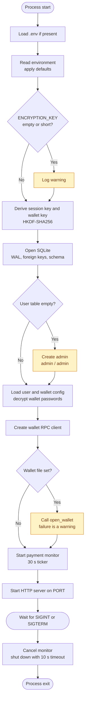
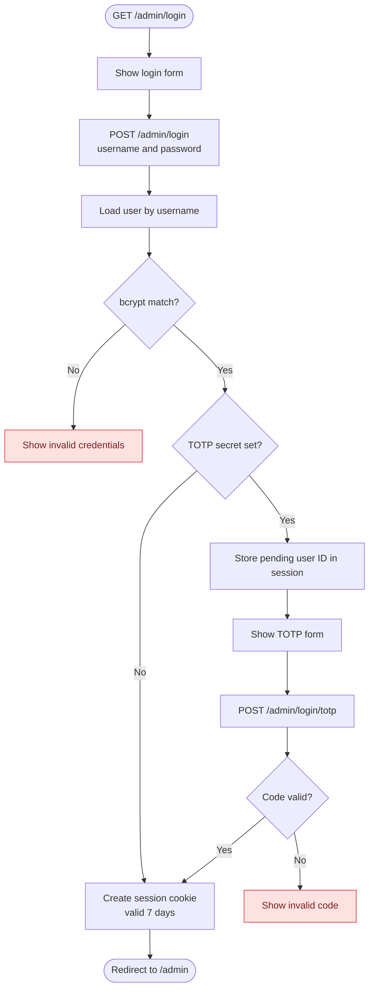
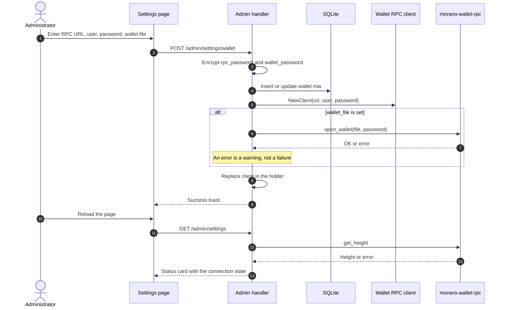
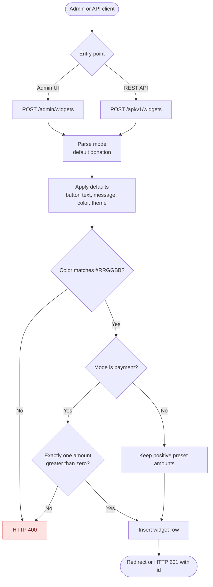
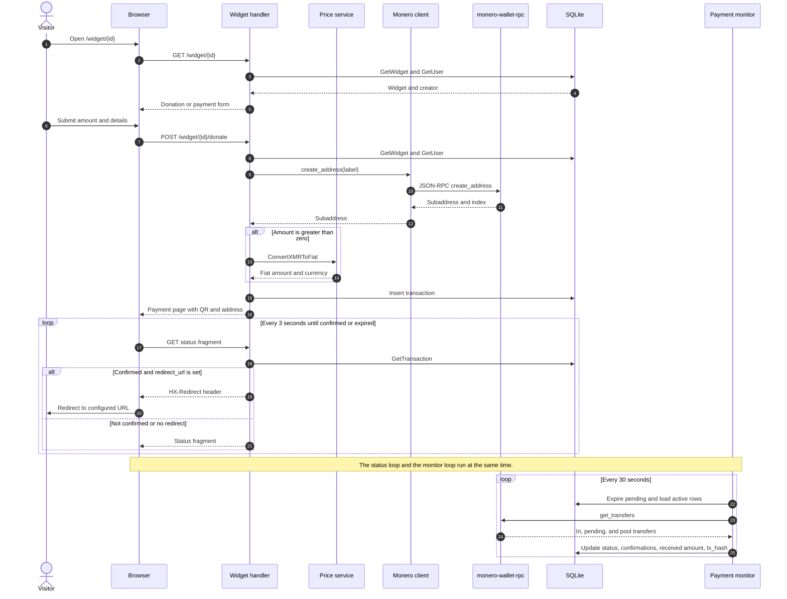
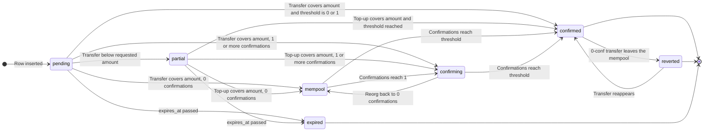
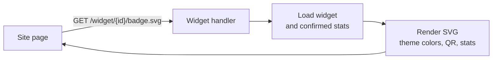
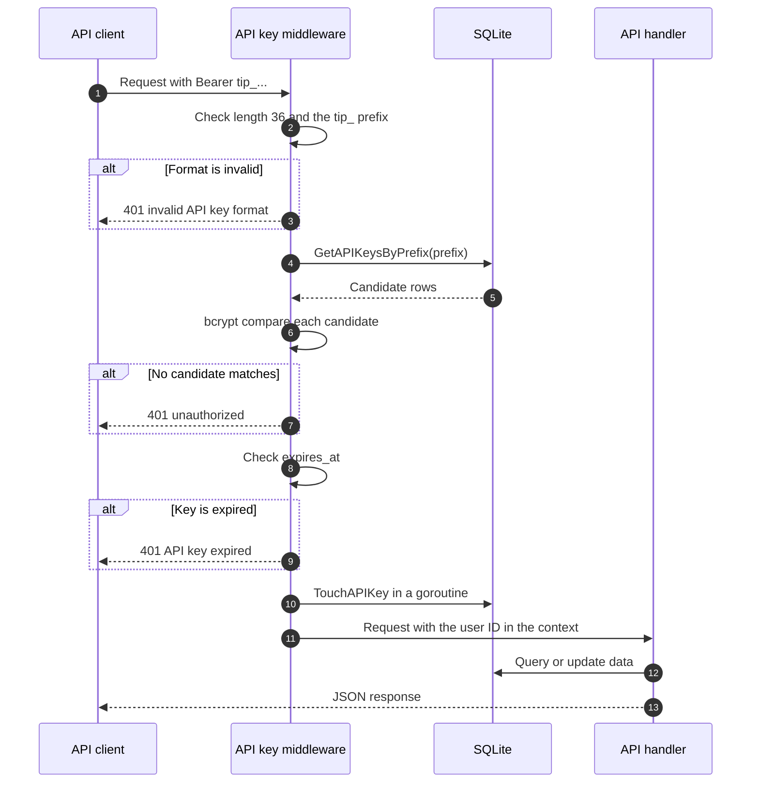

# Flows and Business Logic

This document explains what Tiponero Core does, in the order that a user or a maintainer meets each flow. Each section gives the trigger, the code path, the rules, and the result.

**Audience:** maintainers, operators, integrators.

**Scope:** user-visible behavior and the business rules behind it. Runtime parts are in [architecture.md](./architecture.md). The database schema is in [data-model.md](./data-model.md).

## 1. Actors and entry points

| Actor | Entry point | Goal |
|---|---|---|
| Administrator | `/admin` | Configure the wallet, create widgets, review transactions |
| Visitor | `/widget/{id}` | Pay or donate XMR |
| Site owner | `/widget/{id}/badge.svg` | Show a live badge on a web page |
| API client | `/api/v1` | Automate widgets, transactions, and wallet settings |

| Flow | Trigger | Authentication |
|---|---|---|
| Bootstrap | Process start | None |
| Admin login | `POST /admin/login` | Password, optional TOTP |
| Wallet setup | `POST /admin/settings/wallet` | Admin session |
| Widget creation | `POST /admin/widgets` or `POST /api/v1/widgets` | Admin session or API key |
| Donation or payment | `POST /widget/{id}/donate` | None |
| Status polling | `GET /widget/{id}/donation/{tx}/status` | None |
| Badge request | `GET /widget/{id}/badge.svg` | None |
| API request | `/api/v1/*` | Bearer API key |

## 2. Startup and bootstrap

| Step | Code | Result |
|---|---|---|
| Load `.env` | `godotenv.Load` | Missing file is normal |
| Read environment | `config.Load` | Defaults fill missing values |
| Derive keys | `crypto.DeriveKey` | Session key and wallet key |
| Open database | `database.NewDB` | WAL mode, foreign keys, schema |
| Seed admin | `seedUser` | `admin` / `admin` on an empty database |
| Load wallet | `db.GetWalletConfig` | Decrypts the RPC and wallet passwords |
| Open wallet | `client.OpenWallet` | Warning on failure, process continues |
| Start monitor | `services.NewPaymentMonitor` | Goroutine with a 30 second ticker |
| Start server | `http.Server` | Listens on `PORT` |

Rules:

- The default admin exists only when the `user` table has no rows.
- A missing wallet row gives an empty wallet config. The process starts and the wallet is "not configured".
- `open_wallet` runs only when `wallet_file` is not empty. A failure does not stop the process.
- The first monitor poll happens 30 seconds after start, not at start.
- The HTTP server starts after the monitor goroutine. Both use the same database handle.

## 3. Admin login

Rules:

- The password check uses bcrypt with the default cost.
- When `totp_secret` is not empty, the password step does not create a session. It stores a pending user ID in the session and shows the code form.
- The TOTP form loads the single user and compares the ID with the pending ID. A mismatch clears the pending state.
- A valid code creates the session and clears the pending state.
- The code names the session cookie `tiponero-session`. It is `HttpOnly`, `SameSite=Lax`, and `Secure` when `BASE_URL` starts with `https`.
- Session lifetime is 7 days.
- `POST /admin/logout` destroys the session.
- Every other `/admin` route redirects to `/admin/login` when the session is missing.
- The login form is rate limited per IP. There is no account lockout.

TOTP setup:

- Settings > Enable 2FA generates a secret and a QR code. The app stores the pending secret in the session.
- The admin enters a code from the authenticator app. A valid code saves the secret to the user row.
- Disable 2FA requires a valid current code.

## 4. Wallet RPC setup

Rules:

- The app stores the RPC URL and RPC user in plain text. It encrypts the RPC password and the wallet password with AES-256-GCM.
- The app derives the encryption key from `ENCRYPTION_KEY` with HKDF-SHA256 and the context string `wallet`.
- `SaveWalletConfig` inserts a row when the user has no wallet row. It updates the existing row otherwise.
- The handler creates a new client and replaces the old client in the holder under a mutex. In-flight requests finish with the old client.
- The handler does not call `get_height` before it saves. The status card shows the result on the next page load.
- The status card reports three states: not configured, configured but not connected, and connected with a block height.
- `open_wallet` failure does not block the save.
- The REST API can create a wallet and update the URL, user, and wallet file. It cannot change the passwords. Use the admin settings page for passwords.
- `POST /api/v1/wallet` returns HTTP 409 when a wallet already exists.

## 5. Widget creation and publication

Rules:

| Field | Admin UI | REST API |
|---|---|---|
| `name` | Required by the browser form, not by the server | Required, HTTP 400 when empty |
| `mode` | `donation` or `payment`, default `donation` | Same, unknown values become `donation` |
| `theme` | `system`, `light`, or `dark`, default `system` | Same, unknown values become `system` |
| `preset_amounts` | JSON array built by Alpine.js | JSON array |
| Payment presets | Exactly one value greater than zero | Same |
| Donation presets | Optional, the handler removes non-positive values | Same |
| `primary_color` | `#RRGGBB`, default `#ff6600` | Same |
| `button_text` | Default `Donate`, or `Pay` in payment mode | Same |
| `custom_message` | Default `Your support is appreciated!` | Same |
| `thank_you_message` | Optional text field; default depends on mode | Accepted from the request; default depends on mode |
| `show_stats` | Checkbox, on when present | Boolean, default `true` |
| `redirect_url` | Trimmed text, browser checks the URL format | Stored as given |

After creation, the widget list shows four publication options:

| Option | Value |
|---|---|
| Widget URL | `BASE_URL/widget/{id}` |
| Embed code | `<iframe src="BASE_URL/widget/{id}" width="400" height="600" frameborder="0"></iframe>` |
| Badge URL | `BASE_URL/widget/{id}/badge.svg` |
| Markdown | `` |

The admin UI can create and delete widgets. It has no edit form. Use `PATCH /api/v1/widgets/{id}` to change an existing widget.

`DELETE /admin/widgets/{id}` removes the widget row. Existing transactions keep their rows, and `widget_id` becomes NULL. The public widget page then returns HTTP 404.

## 6. Donation and payment flow

This is the main flow. It starts when a visitor opens a widget and ends when the monitor confirms the payment or the transaction expires.

### 6.1 Widget page

| Mode | Form content | Amount source |
|---|---|---|
| Donation | Preset buttons, custom amount input, name, note | Selected preset or custom input. Empty means any amount |
| Payment | Fixed amount, note | Hidden field with the first preset amount |

- The handler loads the widget by ID. A missing widget returns HTTP 404.
- The handler loads the single user row for the display name, bio, and avatar.
- The page applies the widget theme and the primary color.
- A donation with an empty amount field creates an open-amount transaction. The payment page then shows "Any amount".

### 6.2 Transaction creation

1. In payment mode, read the single preset amount from the widget. Ignore the form amount.
2. In donation mode, read `custom_amount` first, then `amount`.
3. Convert the text to XMR with `strconv.ParseFloat`.
4. Convert XMR to piconero with `math.Round(xmr * 1e12)`.
5. Treat an unparseable value, NaN, infinity, overflow, or a value of zero or less as `0`.
6. Log a warning when the raw value is not empty but the result is `0`. This applies to donation mode only.
7. Generate a label: `tx-` plus 16 random bytes in hex.
8. Call `create_address` with account index `0`.
9. Copy the widget mode into `is_payment`.
10. Set `expires_at` to now plus `TRANSACTION_EXPIRY`.
11. When the amount is greater than zero, snapshot the fiat value and the currency.
12. Insert the row with status `pending`.
13. Render the payment page.

In payment mode, the handler reads the preset from the widget. A widget with no valid preset shows the configuration error page and stores no transaction.

A wallet RPC error stops the flow. The handler stores no transaction row. The visitor sees one of two messages:

| Error | Message |
|---|---|
| `ErrNotConfigured` | Payments are not available yet. The wallet has not been configured. |
| Any other error | Wallet is currently unavailable. Please try again later. |

The app stores the requested amount in `amount`. It stores the received amount in `received_amount` after the monitor sees a transfer.

### 6.3 Payment page

- The page shows the amount, a QR code, and the full subaddress.
- The QR code is a PNG from `/widget/qr/{transactionID}`.
- The QR content is `monero:<subaddress>`. When the amount is greater than zero, it adds `?tx_amount=<XMR>` with 12 decimal places.
- The QR response has `Cache-Control: public, max-age=3600`.
- The status component polls every 3 seconds while the status is not `confirmed` and not `expired`.
- When `redirect_url` is set, the page warns the visitor not to close the window and installs a `beforeunload` handler. The browser removes the handler when it receives an `HX-Redirect` header.

### 6.4 Status polling

1. The handler reads the transaction by ID.
2. It checks that `widget_id` matches the widget in the path. A mismatch returns HTTP 404.
3. When the status is `confirmed` and the widget has a redirect URL, the handler sets `HX-Redirect`.
4. It renders the status fragment.

The status fragment contains no polling attributes for `confirmed` and `expired`. The browser stops polling at these two states.

### 6.5 Payment monitor

The monitor runs in one goroutine with a 30 second ticker. Each cycle does these steps:

1. Set `status = expired` for rows with `status` in `pending` or `partial` and `expires_at < now`.
2. Load rows with status `pending`, `mempool`, `confirming`, `partial`, or `reverted`.
3. Stop when the list is empty.
4. Stop when the wallet RPC URL is empty.
5. Call `get_transfers` with `in`, `pending`, and `pool` set to true.
6. Deduplicate transfers by transaction hash and subaddress index. Keep the entry with the highest confirmation count.
7. Sum the amounts for each subaddress. Keep the highest confirmation count and the hash of that transfer.
8. For each active transaction, find the total for the same subaddress.
9. Resolve the new status from the received amount and the confirmation count.
10. Update the row when the status, the confirmation count, or the received amount changed.

Status resolution:

| Condition | Status |
|---|---|
| Received amount is below `amount` for a fixed-amount transaction | `partial` |
| Received amount covers `amount`, 0 confirmations | `mempool` |
| Received amount covers `amount`, 1 to `CONFIRMATIONS - 1` confirmations | `confirming` |
| Received amount covers `amount`, `CONFIRMATIONS` or more confirmations | `confirmed` |

For an open-amount donation (`amount = 0`), any positive received amount covers the request.

The monitor writes `status`, `confirmations`, `received_amount`, `tx_hash`, and `updated_at`. On confirmation it also writes `confirmed_at`.

The monitor requires the received amount to cover the requested amount. It does not tolerate an underpayment. An overpayment is accepted and stored.

### 6.6 Confirmation and redirect

- The transaction becomes `confirmed` when the received amount covers `amount` and the confirmation count reaches `CONFIRMATIONS`. The default is 10.
- A transfer below the requested amount sets `partial`. The page shows the required and received amounts, and the visitor can send the remaining amount to the same address.
- The payment page shows "Thank you!" for a donation and "Payment confirmed!" for a payment.
- A redirect happens only during a status poll. The visitor must keep the page open.
- When the visitor closes the page, the monitor still confirms the transaction. No redirect happens.
- The monitor stops tracking a row after it becomes `confirmed`.

### 6.7 Expiry

- Expiry applies to rows in `pending` and `partial`.
- The sweep runs every 30 seconds, so a row can expire up to 30 seconds after `expires_at`.
- An expired row is no longer in the active set. A payment to its subaddress after expiry is not detected and not recorded.
- Rows in `mempool` or `confirming` have no expiry. A transfer that stays in the mempool keeps the transaction and the page active. The page shows the normal waiting state. There is no "stuck" label.
- The status page shows the expired message and stops polling.

## 7. Transaction state machine

| State | Meaning | Terminal |
|---|---|---|
| `pending` | Row exists, no transfer seen | No |
| `partial` | Transfer seen, total below the requested amount | No |
| `mempool` | Transfer covers the amount, 0 confirmations | No |
| `confirming` | Transfer covers the amount, 1 or more confirmations, below threshold | No |
| `confirmed` | Amount covered and confirmation threshold reached | Yes, except for 0-conf |
| `reverted` | A 0-conf payment left the mempool inside the revert window | No |
| `expired` | The request closed at `expires_at`. `received_amount` holds any partial payment | Yes |

Notes:

- The monitor derives the state from the received amount and the confirmation count on every poll. It does not keep a separate history.
- A top-up can move `partial` to `mempool`, `confirming`, or `confirmed`.
- A chain reorganization can lower the count for an active row. A dropped transfer can lower the total and move an active row to `partial`.
- `confirmed` is final when the threshold is one or more. A row with `confirmations_required = 0` stays under watch for two hours, because a mempool payment can still disappear. Such a row can move to `reverted` and back to `confirmed`.
- `expired` is final because the row leaves the active set. The row keeps `received_amount` so a partial payment is still visible.
- `pending` and `partial` rows expire. There is no timeout for `mempool` or `confirming`.
- The required confirmations come from the transaction, then the widget, then the global `CONFIRMATIONS` value. Zero means a mempool payment is enough.
- Every state change enqueues a webhook and channel delivery for the matching event.

## 8. Badge flow

Rules:

- The badge endpoint has no authentication.
- A missing widget returns HTTP 404.
- When `show_stats` is true, the handler counts confirmed transactions and sums their received amounts. Rows confirmed by an older version fall back to the requested amount.
- When `show_stats` is false, the badge shows "Donate with Monero".
- The QR code encodes `BASE_URL/widget/{id}`.
- The badge uses the widget theme colors and the primary color for the button text.
- The response has `Cache-Control: no-cache, no-store, must-revalidate`.
- The sum uses the received amounts. Open-amount donations add their received amount to the sum.

## 9. REST API access

Rules:

- The raw key has the form `tip_` plus 32 lowercase hex characters. The total length is 36.
- The prefix is the 8 characters after `tip_`. The app stores it in plain text and indexes it.
- The middleware loads all rows with that prefix and compares the full key with bcrypt.
- The middleware rejects an expired key.
- A valid request updates `last_used_at` in a background goroutine. The response does not wait for the write.
- The handler receives the user ID from the key, not from the request body.
- The API sends no CORS headers. Browser clients on another origin cannot call it.
- The API allows 240 requests per minute per IP.

Response conventions:

| Case | Body | Status |
|---|---|---|
| Read one | `{"data": {...}}` | 200 |
| Read list | `{"data": [...]}` | 200 |
| Create | `{"id": "..."}` | 201 |
| Update | `{"data": {...}}` | 200 |
| Delete | `{"deleted": "..."}` | 200 |
| Error | `{"error": "message"}` | 4xx or 5xx |

`GET /api/v1/transactions` accepts `status`, `page`, and `limit`. The default limit is 20 and the maximum is 100. The response adds a `pagination` object with `page`, `limit`, `total`, and `total_pages`.

Create API keys in the admin settings page. The page shows the raw key once. The maximum lifetime is 365 days.

## 10. Admin review and export

| Page | Data | Rules |
|---|---|---|
| Dashboard | Confirmed total, pending count, today total, recent 10 | "Today" uses UTC midnight |
| Transactions | Filtered list, 10 rows per page | Status filter, the handler clamps the page to the last page |
| Transaction detail | One transaction and its widget | Only the owner can read it |
| CSV export | All transactions of the user | No filter, RFC 3339 timestamps |

Dashboard statistics:

- Total received: count and sum of the effective received amount for confirmed rows. The effective value is `COALESCE(NULLIF(received_amount, 0), amount)`.
- Pending: count of rows in `pending`, `mempool`, `confirming`, and `partial`.
- Today: count and sum for confirmed rows with `confirmed_at` at or after UTC midnight.

The CSV columns are: ID, Type, Amount (XMR), Received (XMR), Fiat Amount, Fiat Currency, Status, Donor, Note, TX Hash, Created, Confirmed.

## 11. Failure paths

| Condition | Visitor or client sees | Data effect |
|---|---|---|
| Widget ID not found | HTTP 404 | None |
| Wallet RPC not configured | Error page, "Payments are not available yet" | No transaction row |
| Wallet RPC returns an error | Error page, "Wallet is currently unavailable" | No transaction row |
| Database insert fails | HTTP 500 | No transaction row |
| QR generation fails | HTTP 500 for the image | Transaction row remains |
| CoinGecko fails with no cached price | Payment page with fiat value `0` | Transaction row remains |
| CoinGecko fails with a cached price | Stale price snapshot | Transaction row remains |
| Status request uses the wrong widget ID | HTTP 404 | None |
| Transfer never arrives | Page shows expired after `TRANSACTION_EXPIRY` | Row becomes `expired` |
| Transfer is below the requested amount | Page shows partial, with required and received amounts | Row becomes `partial`, not confirmed |
| Transfer arrives after expiry | No change, the page shows expired | Row stays `expired` |
| Wallet RPC fails during a poll | Status stays at the last value | Next poll retries |
| Wallet RPC call exceeds 30 s | Request fails with a timeout error | Check the RPC and the network |
| API key is invalid or expired | JSON error with HTTP 401 | None |

## 12. Timing and limits

| Item | Value | Source |
|---|---|---|
| Widget status poll | 3 s | `status.templ` |
| Monitor poll | 30 s | `monitor.go` |
| Expiry sweep | 30 s | `monitor.go` |
| Price cache | 5 min | `price.go` |
| CoinGecko timeout | 10 s | `price.go` |
| Wallet RPC timeout | 30 s | `monero/client.go` |
| QR image cache | 1 h | `widget.go` |
| Session lifetime | 7 days | `auth.go` |
| API key maximum lifetime | 365 days | `admin.go` |
| Default confirmations | 10 | `config.go` |
| Default transaction expiry | 1 h | `config.go` |
| Graceful shutdown timeout | 10 s | `main.go` |
| Admin list page size | 10 | `admin.go` |
| API list default and maximum | 20 and 100 | `api.go` |

## 13. Behavior notes for maintainers

1. The app stores the requested amount in `amount` and the total received amount in `received_amount`. For an open-amount donation, `amount` is `0` and `received_amount` is the actual transfer total.
2. Statistics and the badge use the received amount for confirmed rows. Rows confirmed by an older version have `received_amount = 0`, so the queries fall back to the requested amount.
3. Payment mode ignores the browser form amount and uses the widget preset or the fiat price. The API can set an amount explicitly because an API key is a trusted caller.
4. The monitor sums all transfers to the subaddress and requires the total to cover the requested amount. A transfer below the requested amount sets `partial` and is never confirmed.
5. Expired transactions leave the active set. A late payment to an expired subaddress is not detected. A partial payment at expiry becomes `expired`, and `received_amount` keeps the amount that arrived.
6. `pending` and `partial` rows expire. A transfer that stays in the mempool keeps the row and the page active without a timeout. The page shows the normal waiting state. There is no "stuck" label.
7. The widget confirmation bar uses `CONFIRMATIONS`.
8. The widget page renders `thank_you_message` after confirmation. The admin form defaults it by mode; the API accepts it.
9. The admin UI and the REST API can both edit a widget. Both paths use the same validation.
10. The application serves one user. `GetUser()` reads the first row only.
11. Admin forms carry a CSRF token that matches the `tiponero_csrf` cookie. The session cookie uses `SameSite=Lax`.
12. A per-IP rate limiter covers login, widget creation, the admin panel, and the API. Set `TRUST_PROXY=true` only behind a proxy you control.
13. The schema migrates on startup. `internal/database/sqlite.go` adds any missing column with an idempotent `ALTER TABLE`.
14. `get_transfers` returns every transfer of the wallet. The monitor deduplicates by transaction hash and subaddress index, then sums by subaddress.
15. A chain reorganization can lower the state of an active transaction. A confirmed transaction is no longer polled and keeps its state.
16. The monitor starts its first cycle 30 seconds after process start.
17. A widget delete keeps its transactions and sets `widget_id` to NULL.
18. The stored `tx_hash` is the hash of the highest-confirmation transfer. If a subaddress has several transfers, the other hashes are not stored.
19. An open-amount donation has no fiat snapshot because the amount is unknown at creation. The fiat columns stay `0`.

## Related documents

- [System architecture](./architecture.md)
- [Data model](./data-model.md)
- [Documentation index](./README.md)

## 14. Notification flow

1. A state change writes the transaction row.
2. The monitor calls `Dispatcher.Emit`, which reads the active webhooks and channels for the user.
3. Each endpoint that subscribes to the event gets one `notification_delivery` row. The row holds the full JSON payload.
4. `DeliveryWorker` reads due rows every five seconds. A webhook call carries an HMAC-SHA256 signature over `<timestamp>.<body>`.
5. A success marks the row delivered. A failure increments `attempts` and sets `next_retry_at`. After six attempts the row is marked failed.
6. The admin Notifications page shows the last 25 deliveries and the pending and failed counts.
